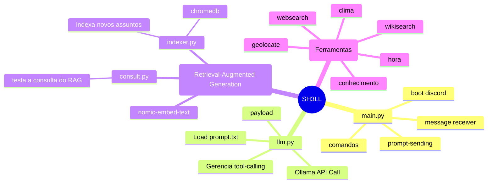

<div align="center">

# SH3LL

**Modular e Preciso.**

[](https://github.com/trilifer404/sh3lldiscordbot/actions/workflows/tests.yml)
[](https://www.python.org/)
[](https://ollama.com/)
[](https://www.trychroma.com/)
[](LICENSE)
[]([https://discord.com/](https://discord.com/oauth2/authorize?client_id=1547749970403270676&permissions=68608&integration_type=0&scope=bot+applications.commands))

</div>
---

## 📖 Sobre

SH3LL é um bot de Discord que roda uma LLM localmente via Ollama, sem comunicação com servidores externos. Combina tool calling sob demanda, memória persistente por usuário em SQLite e uma base vetorial (RAG) com temas indexados da Wikipédia. 
<br>Com uma arquitetura modular, cada ferramenta é um arquivo independente em modules, e o modelo pode ser trocado alterando uma linha em llm.py.


---

## ✨ Funcionalidades

- 🧠 **LLM local** — Via Ollama, sem comunicação com servidores externos.
- 🛠️ **Tool calling** — Ferramentas de câmbio, localização, busca na web (via DuckDuckGo) e na Wikipédia.
- 💾 **Banco de Dados Local** — Histórico de conversação e memórias factuais sobre o usuário em SQLite, tudo localmente.
- 📚 **RAG em subconjunto** — base vetorial com temas de história, filosofia e ciência, indexada com `nomic-embed-text`.
- 🌍 **Multilíngue** — Responde na língua que o usuário enviar.
- 🧪 **Testes automatizados** — 27 testes com pytest e CI via GitHub Actions

---

## 🛠️ Ferramentas disponíveis

| Ícone | Ferramenta | Descrição |
| :---: | :--- | :--- |
| 🕐 | `obter_hora` | Data e hora exatas do sistema |
| 🌤️ | `obter_clima` | Condições climáticas atuais |
| 📍 | `geolocate` | Cidade → coordenadas geográficas |
| 💱 | `obter_cambio` | Cotação entre duas moedas |
| 📖 | `consultar_wikipedia` | Resumo factual de artigos |
| 🔍 | `buscar_web` | Busca na web para dados atualizados|_
| 🗂️ | `consultar_conhecimento` | Base vetorial local (RAG) |


## 🚀 Instalação

```bash
git clone https://github.com/trilifer404/sh3lldiscordbot.git
cd sh3lldiscordbot

python -m venv .venv
source .venv/bin/activate   # Linux/macOS
# .venv\Scripts\activate    # Windows

pip install -r requirements.txt

ollama pull granite4.2:8b
ollama pull nomic-embed-text
```

## ⚙️ Requisitos

### Infraestrutura

| Requisito | Versão |
| :--- | :--- |
| Python | 3.12+ |
| Ollama | latest |
| RAM | 16 GB recomendado |
| VRAM | 6 GB+ recomendado |

### Modelos


| Modelo | Uso |
| :--- | :--- |
| `granite4.2:8b` | LLM principal |
| `nomic-embed-text` | Embeddings do RAG |

### Modelo de linguagem

O projeto foi desenvolvido e testado com o **`granite4.2:8b`** rodando via Ollama. No entanto, a arquitetura é totalmente modular e adaptável: qualquer modelo compatível com a API do Ollama pode ser usado, desde que suporte tool calling.

Para trocar o modelo, altere uma única linha em `llm.py`:

```python
OLLAMA_MODEL = "granite4.2:8b"  # troque pelo modelo que preferir
```
### Bibliotecas Python

Instaladas automaticamente com `pip install -r requirements.txt`:

| Biblioteca | Uso |
| :--- | :--- |
| `discord.py` | Cliente do Discord |
| `requests` | Chamadas HTTP ao Ollama |
| `python-dotenv` | Leitura do `.env` |
| `ddgs` | Busca web via DuckDuckGo |
| `langchain-ollama` | Integração com Ollama |
| `langchain-chroma` | Banco vetorial |
| `langchain-community` | Loaders de documentos |
| `langchain-core` | Base do LangChain |
| `langchain-text-splitters` | Divisão de textos em chunks |
| `chromadb` | Banco vetorial |
| `wikipedia` | Consulta à Wikipédia |
| `pytest` | Testes |

# Configuração

Coloque seu discord bot token na .env
```dotenv
DISCORD_TOKEN=seu_token_aqui
```
Troque o ID do Owner (Proprietário) na `main.py`

```python
OWNER = 123456789012345678 # substitua pelo seu ID de usuário do Discord
```

# ▶️ Uso
Rode no prompt de comando:
```bash
python bot.py
```
No discord, somente mencione o bot para que a LLM responda e funcione.
Tenha certeza que o OLLAMA está ligado e o modelo também.
# Comandos inclusos:

| Comando | Uso |
| :--- | :--- |
| `$reset` | Apaga o seu histórico com o Bot, comando livre.|
| `$reload` | Recarrega os módulos |

## 🏗️ Arquitetura
Essa é a arquitetura-base do projeto SH3LL Discord.



## 📚 Como funciona o RAG

Retrieval-Augmented Generation é uma técnica de Inteligência Artificial que conecta LLMs a dados externos produzidos por humanos ou por outros datasets.
Nesse caso, usamos o les nomic-embed-text parar fazer embeddings dos artigos da Wikipédia, uma fonte confiável da web, armazenamos esses artigos no ChromeDB
<br>No conceito inicial do projeto, foi pensado que o RAG seria uma fonte de conhecimento opcional quando não se tem o dado necessário dentro dos parâmetros do modelo.
Mostrou bons resultados no modelo `granite4.2:8b`.


```mermaid
    flowchart LR
        P[Pergunta] --> E[Embedding<br/>nomic-embed-text]
        E --> V[(ChromaDB<br/>busca vetorial)]
        V --> F[Filtro por score]
        F --> C[Contexto injetado]
        C --> G[Modelo <br/>sintetiza]
        G --> R[Resposta final]
   ```
Adicione esta seção no README, logo após **Como funciona o RAG**. Ela cobre exatamente o que você levantou: a base vetorial não acompanha o repositório e o usuário precisa construí-la.

---

## 🧱 Construindo sua base vetorial

A pasta `chroma_db/` **não acompanha o repositório** — ela está no `.gitignore` porque cada usuário tem seus próprios temas indexados, e a base pode ocupar centenas de megabytes. Antes de rodar o bot pela primeira vez, você precisa construir a sua base.

### 1. Edite a lista de temas

Abra `indexer.py` e edite a lista `TEMAS` com os assuntos que você quer disponibilizar:

```python
TEMAS = [
    "Inconfidência Mineira",
    "Tiradentes",
    "História do Brasil",
    "Filosofia estoica",
    "Física Quântica",
    # adicione seus próprios temas
]
```

Os temas são títulos de artigos da Wikipédia em português. Você pode verificar se um tema existe antes de adicionar abrindo `https://pt.wikipedia.org/wiki/Nome_do_Tema` no navegador.

### 2. Rode o indexador

Com o Ollama ligado e o modelo `nomic-embed-text` baixado:

```bash
python indexer.py
```

O script percorre cada tema, baixa o artigo da Wikipédia, divide o texto em pedaços e salva os embeddings no ChromaDB. A saída mostra quantos pedaços foram indexados por tema.

O processo é **incremental**: se você rodar de novo depois de adicionar um tema novo, só os temas inéditos serão indexados. Os que já estão na base são pulados.

### 3. Teste a base (opcional)

Antes de rodar o bot, você pode testar a recuperação com:

```bash
python consult.py
```

Faça perguntas sobre os temas que você indexou. Se as respostas vierem corretas, a base está pronta.

### 4. Adicionando mais temas depois

Edite `indexer.py`, acrescente os novos temas e rode `python indexer.py` de novo. A base cresce sem perder o que já estava lá.

### Estrutura da pasta

```
chroma_db/          # criada automaticamente pelo indexer.py
└── ...             # arquivos internos do ChromaDB
```

A pasta é criada na primeira execução do `indexer.py`. Se apagar, o bot continua funcionando, mas a ferramenta `consultar_conhecimento` retornará "nenhum trecho relevante" até você rodar o indexador novamente.


## 📜 Licença

Este projeto está licenciado sob a **PolyForm Noncommercial License 1.0.0**.

- ✅ Uso pessoal, educacional e por organizações sem fins lucrativos
- ❌ Uso comercial sem autorização prévia por escrito
- 📎 Atribuição obrigatória em qualquer redistribuição

Para autorização comercial, entre em contato via issue no repositório.
